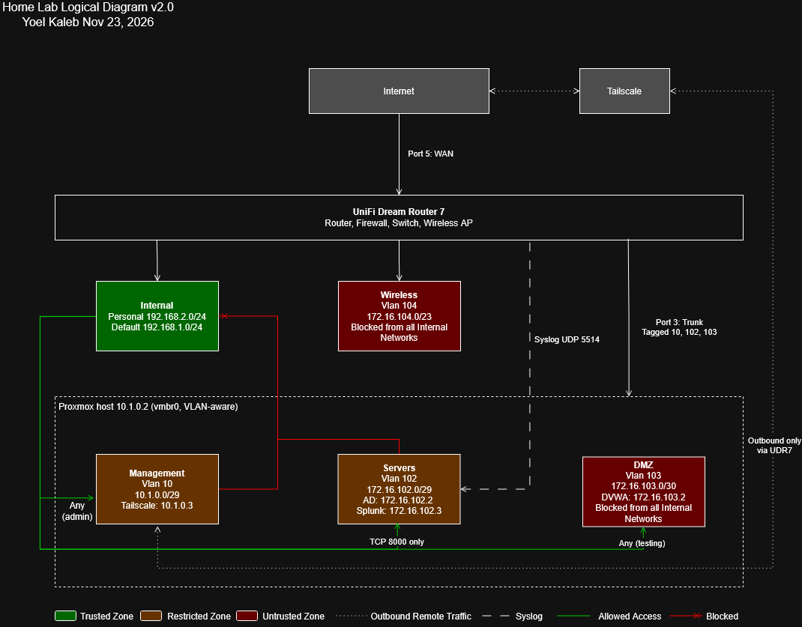
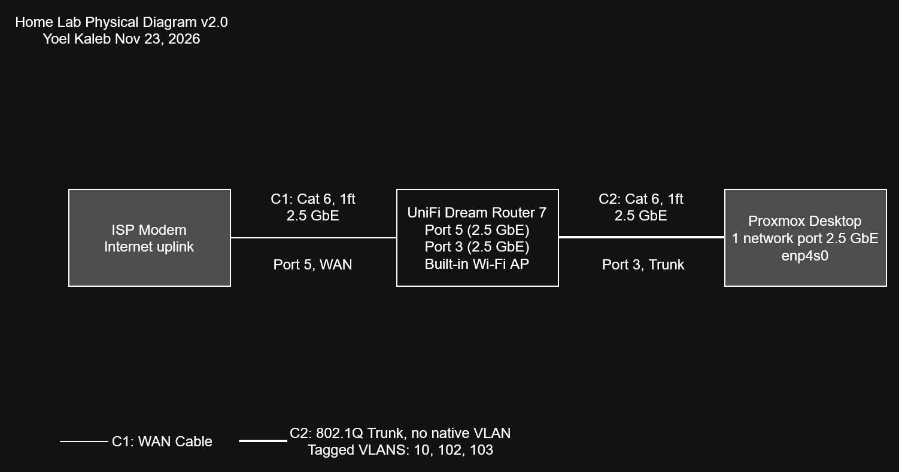

# Home Lab Network Runbook

A segmented home network built on a UniFi Dream Router 7 and a Proxmox host, documented the way a network or infrastructure team would document it: diagrams, IP and VLAN plan, firewall rules, test results, troubleshooting write-ups, and incident and change records.

**Author:** Yoel Kaleb | **Version:** 2.0 | **Last updated:** November 2026

---

## What this project is

I built this lab to practice network segmentation, firewalling, centralized logging, and systems administration, and to document the work clearly enough that someone else could rebuild it or troubleshoot it. The full write-up is in the runbook PDF in this repository.

## What's in this repository

| File | Contents |
|---|---|
| `Home_Lab_Runbook_v2.0.pdf` | The complete runbook (13 sections) |
| `docs/images/logical-diagram.png` | Logical diagram: zones, VLANs, subnets, and allowed and blocked paths |
| `docs/images/physical-diagram.png` | Physical diagram: devices, ports, cables, and link speeds |

## Diagrams

### Logical diagram

### Physical diagram

## Network at a glance

| Network | VLAN | Subnet | Zone | Purpose |
|---|---|---|---|---|
| Default | 1 | 192.168.1.0/24 | Internal | UniFi infrastructure |
| Personal | 2 | 192.168.2.0/24 | Internal | Trusted zone, admin device |
| Management | 10 | 10.1.0.0/29 | Management | Proxmox host, Tailscale node |
| Servers | 102 | 172.16.102.0/29 | Servers | Windows Server AD, Splunk |
| DMZ | 103 | 172.16.103.0/30 | DMZ | Deliberately vulnerable web app (DVWA) |
| Wireless | 104 | 172.16.104.0/23 | Wireless | Untrusted Wi-Fi clients |

**Hardware and software:** UniFi Dream Router 7 (router, firewall, DHCP, Wi-Fi), Proxmox VE 9.0.3, Windows Server 2019 (Active Directory), Splunk Enterprise 10.6 on Ubuntu Server 26.04 LTS, DVWA 2.5, Tailscale.

**Cabling:** Two Cat6 cables at 2.5 GbE. One runs from the ISP modem to the router's WAN port. The other is an 802.1Q trunk from the router to the Proxmox host, carrying VLANs 10, 102, and 103 tagged with no native VLAN.

## Design highlights

- **Zone-based segmentation.** Five firewall zones, with traffic between zones denied by default and explicit policies allowing only what is needed.
- **Least-privilege outbound access.** Servers can reach the internet only on specific ports and, for web and NTP traffic, only from named hosts. Splunk has no internet access.
- **Isolated DMZ.** The DMZ cannot start connections to any internal network. The trusted Personal network can reach it, with return traffic only.
- **Untrusted Wi-Fi.** Wireless clients are blocked from every internal network.
- **Centralized logging.** The router sends syslog to Splunk over UDP 5514 (a high port, because Splunk runs as a non-root user).
- **Minimal remote access.** Tailscale connects outbound only, with no inbound ports opened. The subnet router advertises only the Management network.

## Testing

The runbook includes a testing log with 17 documented tests, all passing, covering:

- Isolation between zones (Wireless, DMZ, Servers, and Management blocked from the networks they should not reach)
- Allowed paths (admin access from Personal, Splunk web interface)
- Remote access over Tailscale from a cellular connection, including a before-and-after test with Tailscale turned off
- Log delivery from the router to Splunk

## Troubleshooting and change records

The runbook documents three real troubleshooting cases in a consistent format (symptom, diagnosis, root cause, fix, verification, and prevention):

1. **Remote access to the Management network failed.** Tailscale was routing to a previously deleted VLAN with the same ID.
2. **Splunk web interface timed out.** A firewall allow rule was configured incorrectly, so traffic fell through to the default block.
3. **Lost access to Proxmox after changing the trunk's native VLAN.** The host's tagged interface did not match the port's new untagged VLAN.

These are tracked as ITIL-style records in a chronological timeline: two incidents, two change requests, and a problem record that connects the incidents.

## Skills demonstrated

- Networking fundamentals: VLANs, subnetting, DHCP, DNS, NAT, trunking, and inter-VLAN routing
- Firewall design and rule documentation
- Network and cabling documentation, including logical and physical diagrams
- Windows Server and Linux administration, and virtualization with Proxmox
- Centralized logging with Splunk
- Troubleshooting with a documented, repeatable method
- Technical writing, testing, and change and incident management

## Known limitations and planned improvements

- The Proxmox host has a single network interface, so VLAN tagging and firewall rules provide all the isolation between Management, Servers, and the DMZ.
- The router is a single point of failure, and one trunk cable carries all lab traffic.
- Planned: add a second network interface, restrict management to named admin devices, enable MFA where supported, use Tailscale access controls to limit which devices can use the advertised route, and schedule configuration backups.

## Notes

This is a personal lab. Private IP ranges are shown for documentation purposes. Credentials, keys, and device-specific identifiers are intentionally left out.

## Contact

Yoel Kaleb | [Linkedin](https://www.linkedin.com/in/yoel-kaleb) | yoelk49@gmail.com
